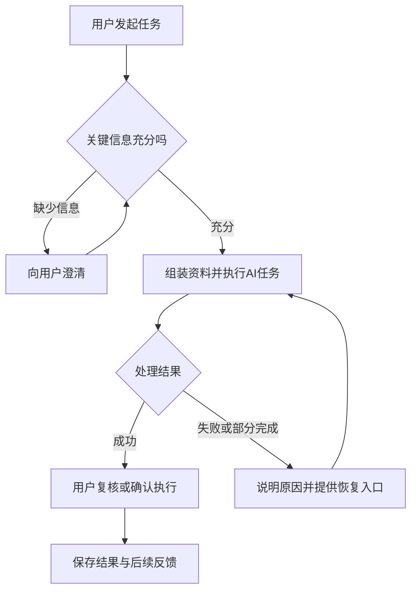
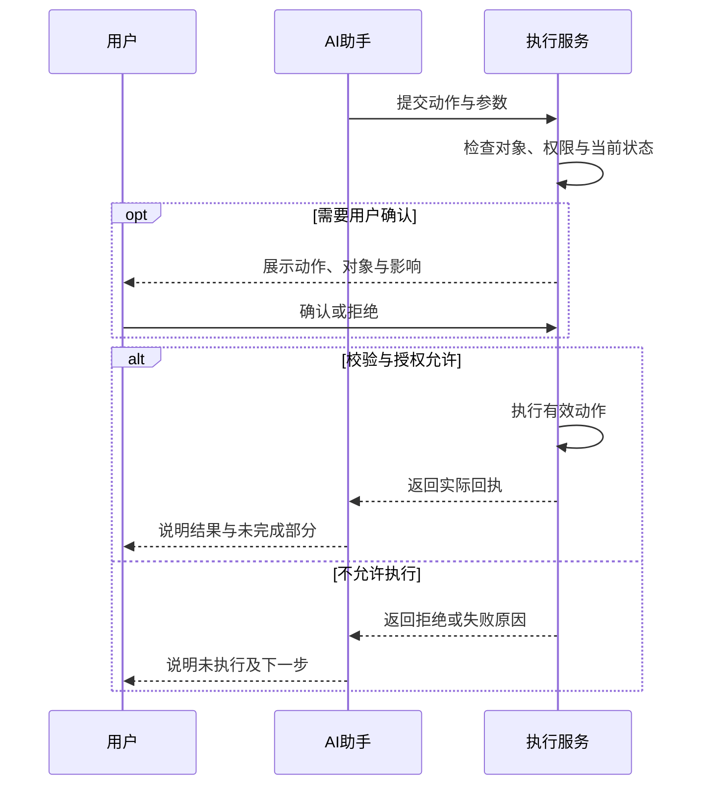

# 〔产品名称〕产品需求文档

[浏览 HTML 排版与原始图示](ai-native-prd-template.html)

版本：〔v0.1〕 状态：〔编写中／评审中／已定稿〕 产品负责人：〔姓名〕 更新日期：〔日期〕<br>参与评审：〔设计、研发、算法、测试、运营及必要的业务负责人〕

**使用说明**：复制本文，按问题填写。方括号内是待填写内容；引用段解释章节的作用，团队熟悉后可移入折叠说明。先写用户、问题、范围和主流程，再逐项补齐功能；最后核对上下文、模型、输出、异常和验收。一个小产品可以合并章节，同一类规则集中维护并从功能中引用。

本文中的“AI”覆盖语言理解、生成、工具决策及多模态能力。按实际产品保留相关内容。PRD中的模型表现、耗时和成本数值应明确是验收目标还是已获得的测试结果。

## 00 文档信息与本次交付

> 本模块帮助所有参与者对齐“这次到底交付什么”。AI产品的表现会受到模型、提示词、资料和工具变化影响，因此除了产品版本，还需要标清本次使用的能力组合、交付范围及重要变更。

### 00.1 这份文档覆盖什么

| 项目 | 填写内容 |
| --- | --- |
| 产品／功能名称 | 〔名称〕 |
| 适用用户与使用端 | 〔谁使用；Web、App、IM、桌面或开放接口〕 |
| 本次要完成的交付 | 〔用户最终能完成哪些事情〕 |
| 本次范围边界 | 〔版本明确包含和暂缓的内容〕 |
| 关联材料 | 〔产品定型稿、交互稿、数据说明、接口文档〕 |
| 依赖能力版本 | 〔模型、提示词、检索、工具、插件的有效版本〕 |

### 00.2 谁确认什么

| 决策事项 | 当前结论 | 决策人 | 确认日期 | 变化时影响哪些章节 |
| --- | --- | --- | --- | --- |
| 〔例如是否允许AI自动发送消息〕 | 〔结论〕 | 〔角色〕 | 〔日期〕 | 〔功能、权限、验收〕 |

**写完自查**：新加入项目的人能否看懂当前有效范围？历史决策和未决事项能否区分？

## 01 产品概述：为谁提供什么价值

> 本模块先建立产品价值。AI能力应落实到具体任务：用户提供什么、系统帮助处理什么、最后交付什么。说明引入LLM的原因，有助于团队判断投入是否值得，以及哪些动作需要程序校验或用户确认。

### 01.1 用一段话介绍产品

〔产品〕帮助〔用户〕在〔场景〕完成〔任务〕。用户输入〔文字／文件／选区／其他信息〕，系统提供〔回答／方案／媒体／已执行的结果〕，使〔可观察的结果〕得到改善。

**写法示例**：帮助售后人员在回复客户前，从适用版本的售后政策中查找条款并生成带来源的答复草稿，减少查找和整理时间。

### 01.2 为什么需要LLM

| 用户任务中的一步 | 这里需要什么能力 | 使用LLM带来的价值 | 出错可能造成什么影响 | 谁负责最终校验 |
| --- | --- | --- | --- | --- |
| 〔例如从聊天中识别问题〕 | 〔理解自由表达〕 | 〔减少重复填写〕 | 〔识别错产品型号〕 | 〔用户确认／系统核对〕 |
| 〔例如按政策生成回复〕 | 〔检索后归纳〕 | 〔帮助组织语言〕 | 〔引用过期条款〕 | 〔版本过滤＋人工复核〕 |

补充〔资料是否可获得、模型是否验证过、延迟与成本是否可接受〕。需要技术方案取舍时，再写候选方案及选择理由。

### 01.3 用户成功的标准

| 用户结果 | 怎样判断完成 | 当前情况 | 本次目标 | 如何采集 |
| --- | --- | --- | --- | --- |
| 〔例如完成一条可发送答复〕 | 〔事实正确、来源适用、客服确认〕 | 〔数据或待测量〕 | 〔目标与依据〕 | 〔埋点、抽样评审〕 |

**写完自查**：能否只看本章就理解产品用途？“智能”“高效”等词是否已经对应到具体结果？

## 02 需求背景：问题是否值得解决

> 本模块解释问题的发生方式、影响和可行性。AI产品常在演示中表现良好，真实任务可能更长、更杂，也可能缺少关键资料。提前写出典型任务与能力验证，能让后续设计保持业务针对性。

### 02.1 用户今天如何完成任务

| 场景／触发 | 现有步骤 | 遇到的问题 | 发生频率与代价 | 已有信息与缺口 |
| --- | --- | --- | --- | --- |
| 〔场景〕 | 〔具体操作〕 | 〔具体困难〕 | 〔耗时、损失等〕 | 〔调研、业务数据；还需了解什么〕 |

### 02.2 用一个完整任务说明需求

- 用户当时的目标：〔目标〕。
- 已有材料：〔实际会出现的输入〕。
- 当前处理过程：〔步骤〕。
- 希望获得的结果：〔可交付内容〕。
- 最担心的错误：〔错误及影响〕。

### 02.3 开发前需要验证什么

| 关键疑问 | 验证任务和样本 | 合格标准 | 负责人 | 不满足时的处理 |
| --- | --- | --- | --- | --- |
| 〔模型能否读懂目标格式〕 | 〔任务与样本来源〕 | 〔判断标准〕 | 〔角色〕 | 〔改变输入、缩小范围、人工处理等〕 |

**写完自查**：问题的重要程度、技术可行性和用户接受程度是否分别有判断方法？

## 03 用户角色与人机分工

> 本模块界定谁能看见哪些资料、谁能发起哪些动作、谁来审核结果。生成建议与实际执行具有不同后果，AI产品需要把这些职责写到具体动作上。

### 03.1 用户角色

| 角色 | 主要任务 | 可提供的信息 | 可访问的资料 | 能否判断AI结果正确 | 管理权限 |
| --- | --- | --- | --- | --- | --- |
| 〔角色〕 | 〔任务〕 | 〔上下文〕 | 〔范围〕 | 〔能力与限制〕 | 〔范围〕 |

### 03.2 哪些动作交给AI

| 动作 | AI可以做到哪一步 | 程序必须检查什么 | 用户何时确认 | 拒绝／超时后怎么办 |
| --- | --- | --- | --- | --- |
| 生成草稿 | 〔直接生成〕 | 〔字段、长度、来源〕 | 〔提交或发送前〕 | 〔保留草稿〕 |
| 修改业务数据 | 〔提出修改／按授权执行〕 | 〔权限、对象、合法值〕 | 〔执行前的范围〕 | 〔停止该动作〕 |

### 03.3 用户如何建立信任

填写〔AI标识、资料来源、适用范围、等待和执行状态、纠错入口、结果编辑、撤销或人工处理入口〕。给出一条“信息不足”文案和一条“执行失败”文案。

**写完自查**：用户能否判断AI正在建议、等待确认还是已经执行？授权能否明确到动作和资源？

## 04 用户旅程与关键交互

> 本模块把功能串成完整体验。AI任务可能出现澄清、长时间等待、流式返回、工具执行、部分成功和重试，因此主流程需要同时画出关键分支与恢复入口。

### 04.1 主旅程

| 阶段 | 用户想完成什么 | 用户操作 | 界面反馈 | 系统／AI动作 | 取得哪些上下文 | 失败出口 |
| --- | --- | --- | --- | --- | --- | --- |
| 准备 | 〔目标〕 | 〔操作〕 | 〔反馈〕 | 〔处理〕 | 〔资料〕 | 〔处理方式〕 |
| 发起 | 〔〕 | 〔〕 | 〔〕 | 〔〕 | 〔〕 | 〔〕 |
| 处理 | 〔〕 | 〔〕 | 〔〕 | 〔〕 | 〔〕 | 〔〕 |
| 复核／执行 | 〔〕 | 〔〕 | 〔〕 | 〔〕 | 〔〕 | 〔〕 |
| 复用 | 〔〕 | 〔〕 | 〔〕 | 〔〕 | 〔〕 | 〔〕 |

### 04.2 流程图

图中至少出现发起、信息是否充分、AI处理、结果复核、完成和失败恢复。按产品实际修改，超过一张图能清楚承载的复杂度时拆分。

<a id="diagram-1"></a>

**图 1 · 可编辑流程示例**



[查看配套 HTML 中的原始图示](ai-native-prd-template.html#diagram-1)

### 04.3 状态与页面行为

| 状态 | 何时进入 | 显示什么 | 用户能做什么 | 如何结束／恢复 |
| --- | --- | --- | --- | --- |
| 待输入 | 〔〕 | 〔〕 | 〔〕 | 〔〕 |
| 生成中 | 〔〕 | 〔〕 | 〔停止等〕 | 〔〕 |
| 等待确认 | 〔〕 | 〔动作、对象、影响〕 | 〔允许／拒绝〕 | 〔〕 |
| 部分完成 | 〔〕 | 〔已成功与失败项〕 | 〔保留／重试〕 | 〔〕 |
| 失败／取消 | 〔〕 | 〔原因与已发生动作〕 | 〔〕 | 〔〕 |

**写完自查**：刷新、断线、切换任务和取消后，用户是否还能理解发生了什么？

## 05 功能需求：逐项说明行为

> 本模块是研发和测试的主要工作依据。每个功能都要讲清入口、输入、步骤、规则、结果和异常。涉及AI时继续补齐上下文、提示词、输出与恢复；普通功能如果给AI提供资料，也要说明它对后续任务的影响。

### 05.1 功能目录

| 编号 | 功能 | 用户价值 | 类型 | 优先级及理由 | 依赖 |
| --- | --- | --- | --- | --- | --- |
| F01 | 〔名称〕 | 〔价值〕 | 〔普通／上下文供给／AI／复合〕 | 〔理由〕 | 〔依赖〕 |

### 05.2 普通功能写作卡（按功能复制）

**F〔编号〕 〔功能名称〕**

- **用户目标与入口**：〔谁，从哪里，为什么使用〕。
- **前置条件**：〔登录、权限、数据状态、配置〕。
- **输入与页面字段**：〔字段、类型、是否必填、默认值、校验、说明〕。
- **正常流程**：〔按操作顺序编号，分别写用户动作和系统反馈〕。
- **业务规则**：〔排序、唯一性、归属、可编辑范围、并发变化等〕。
- **结果与保存**：〔成功后看见什么；保存哪些数据；影响哪些对象〕。
- **异常处理**：〔空值、非法输入、权限不足、重复操作、保存失败〕。
- **验收**：〔给定条件→用户动作→可以观察到的结果〕。

**如果该功能为AI提供资料，继续填写**：

| 提供什么 | 来自哪里／属于谁 | 什么时候送给AI | 编辑／删除后怎样生效 | 缺失或过期怎么办 | 用户如何看见 |
| --- | --- | --- | --- | --- | --- |
| 〔例如选中图片与顺序〕 | 〔对象ID、所有者〕 | 〔提交当前任务时〕 | 〔重算输入；旧产物处理〕 | 〔阻止／降级／提示〕 | 〔缩略图、数量、来源〕 |

### 05.3 AI功能写作卡（按功能复制）

**F〔编号〕 〔AI功能名称〕**

1. **用户任务**：〔一次调用要帮助用户完成什么；何时算完成〕。
2. **入口与输入**：〔自然语言、表单、文件、选区；哪些必需〕。
3. **主要流程**：〔校验→收集资料→调用模型／工具→处理结果→呈现／保存〕。
4. **上下文**：〔使用哪些资料；如何选择；顺序；数量；缺失、过期和冲突处理；引用第06章〕。
5. **模型与参数**：〔需要的能力、有效模型、参数、生效范围；是否允许回退〕。
6. **提示词**：〔可审阅的正文、变量和例子；引用第07章〕。
7. **输出与解析**：〔文本标准／字段／媒体规格；程序怎样判断合法；引用第08章〕。
8. **执行边界**：〔可调用哪些工具；何时审批；怎样判断执行成功〕。
9. **失败与稳定性**：〔超时、拒答、格式错、部分成功、取消、重试和恢复；引用第09章〕。
10. **成本和等待**：〔张数、时长、token、工具调用；如何展示等待和控制消耗〕。
11. **验收**：〔正常、缺信息、错误输入、恶意内容、外部服务失败各自怎样判断〕。

### 05.4 给一个从输入到结果的完整例子

| 环节 | 具体内容 |
| --- | --- |
| 用户输入 | 〔真实场景的输入〕 |
| 实际使用的资料 | 〔内容、来源、版本；排除哪些无关项〕 |
| 发给模型的关键内容 | 〔任务约束、变量替换后的内容〕 |
| 合格输出 | 〔完整输出例子〕 |
| 程序检查 | 〔结构、对象、权限、语义〕 |
| 信息缺失时 | 〔澄清／降级输出例子〕 |
| 服务失败时 | 〔界面状态、保留内容、下一步〕 |

**写完自查**：研发能否不再猜测就完成关键行为？测试能否判断哪些结果合格？

## 06 上下文设计：AI实际看见什么

> 本模块定义AI做判断时可获得的信息。文件、选区、连线、历史、记忆和工具结果都可能改变答案；明确其范围与时效，能避免“用户以为AI已读到，AI实际没有读到”的体验问题。

### 06.1 上下文清单

| 编号／名称 | 内容和业务含义 | 来源功能 | 归属／权限 | 何时读取 | 如何更新、删除 | 谁使用 |
| --- | --- | --- | --- | --- | --- | --- |
| C01 〔名称〕 | 〔字段或例子〕 | 〔功能〕 | 〔范围〕 | 〔时机〕 | 〔规则〕 | 〔AI功能〕 |

### 06.2 一次任务怎样组织资料

按顺序写〔本轮目标→规则和工具→所选材料→相关历史／记忆→检索资料〕的实际组装规则。说明：

- 哪些资料默认使用，哪些需要用户选择？
- 相同资料如何去重、编号、排序？
- 资料过长如何处理，哪些必须保留？截断／摘要后用户如何知道？
- 用户新要求与历史要求冲突时，采用哪个？
- 图片、视频、音频是否真正进入对应模型？能力不足怎样反馈？

### 06.3 知识检索与记忆（适用时填写）

| 问题 | 产品规则 |
| --- | --- |
| 文档怎样变成可查询资料 | 〔上传、解析、索引及状态〕 |
| 怎样限定可查范围 | 〔用户、组织、当前选择、版本〕 |
| 找不到内容怎么办 | 〔无依据反馈、补材料或转其他路径〕 |
| 引用怎样展示 | 〔标题、段落、版本、可访问链接〕 |
| 哪些信息进入长期记忆 | 〔触发和范围〕 |
| 用户怎样查看／修改／删除 | 〔入口与生效范围〕 |

### 06.4 长度与费用预算

填写〔所选模型有效窗口、预留输出、工具说明开销、各资料限额、媒体限制〕。文本字符数与token使用不同单位；估算方式和超限后行为分别记录。长度策略应保留关键任务信息和可回读来源。

**写完自查**：同一任务在不同材料选择、删除或更新之后，系统行为是否可解释？

## 07 提示词与模型流程

> 本模块让团队能直接评审AI的任务说明。提示词应包含具体任务、资料用法、输出规则和失败处理，并通过例子说明；模型选择、工具步骤和停止条件也需要与产品流程对齐。

### 07.1 提示词清单

| 名称 | 用在哪个功能 | 负责什么 | 输入变量 | 版本／负责人 | 关联测试 |
| --- | --- | --- | --- | --- | --- |
| P01 〔名称〕 | 〔功能〕 | 〔任务〕 | 〔变量及类型〕 | 〔版本〕 | 〔用例〕 |

### 07.2 提示词正文（按条复制）

```text
任务：〔具体要完成的子任务〕
资料：〔有哪些输入，标签／字段是什么，允许怎样引用〕
行为规则：〔哪些可以执行，哪些需要确认，什么时候澄清〕
输出：〔内容结构、字段或媒体要求〕
无法完成时：〔缺信息、无依据、权限不足等处理〕
结束条件：〔完成、等待用户、失败、达到运行预算〕
当前目标：〔由程序填入〕
当前资料：〔由程序结构化填入〕
例子：〔一份完整输入和合格输出〕
```

补充一份资料冲突或缺失的例子。资料里的指令如何处理要写清，执行权限还需程序检查。

### 07.3 调用流程与变更管理

填写〔单次调用／固定流程／Agent多步执行〕。多步流程列出每步的输入、输出、分支、等待、停止和恢复；选择模型时说明工具、多模态、结构化能力和数据处理要求。更换模型、提示词、检索规则或工具后，用同一组任务做回归。

**写完自查**：提示词是否可直接评审？版本变化能否定位到具体功能及测试？

## 08 输出、解析与实际执行

> 本模块说明“AI说了什么”怎样变成“用户能使用的结果”。自然语言需要质量标准，结构化内容需要字段和语义检查，工具动作需要真实回执。流式返回、部分结果与最终提交也要区分。

### 08.1 输出内容

| 输出名称 | 给谁使用 | 形态／字段 | 合格标准 | 保存在哪里 | 如何展示 |
| --- | --- | --- | --- | --- | --- |
| O01 〔名称〕 | 〔人／系统〕 | 〔文本、JSON、图片、视频等〕 | 〔标准〕 | 〔对象〕 | 〔界面〕 |

自然语言填写必含要素、来源和风格；结构化内容给字段类型、枚举、必填／可空条件和完整合法例子；媒体填写格式、尺寸／时长、可播放性和保存关联。

### 08.2 解析和校验

| 检查阶段 | 具体检查 | 失败怎么显示 | 能否重试 | 是否允许继续执行 |
| --- | --- | --- | --- | --- |
| 返回完整性 | 〔截断、拒答、空结果〕 | 〔〕 | 〔〕 | 〔〕 |
| 格式 | 〔字段和类型〕 | 〔〕 | 〔〕 | 〔〕 |
| 业务含义 | 〔来源真实、对象存在、范围合法〕 | 〔〕 | 〔〕 | 〔〕 |
| 权限／当前状态 | 〔允许访问和修改〕 | 〔〕 | 〔〕 | 〔〕 |

### 08.3 执行时序（涉及工具或业务写入时填写）

<a id="diagram-2"></a>

**图 2 · 可编辑流程示例**



[查看配套 HTML 中的原始图示](ai-native-prd-template.html#diagram-2)

补充〔重复提交如何避免重复执行、超时后如何查状态、用户停止后已发生动作如何说明、失败如何补偿〕。

**写完自查**：程序是否能阻止格式合法但业务错误的内容直接生效？

## 09 失败恢复、可靠性与安全

> 本模块把不确定性转化为用户能理解、工程能处理的分支。模型、网络、工具和存储有不同失败方式；每种恢复都应说明保留什么、是否重新计费、什么时候停止，以及用户可以怎样接手。

### 09.1 失败矩阵

| 失败情况 | 怎样发现 | 保留哪些内容 | 自动处理与上限 | 用户可做什么 | 最终状态 |
| --- | --- | --- | --- | --- | --- |
| 超时／限流 | 〔〕 | 〔〕 | 〔退避、次数、总时长〕 | 〔〕 | 〔〕 |
| 输出不可用 | 〔〕 | 〔〕 | 〔修复、重做或停止〕 | 〔〕 | 〔〕 |
| 部分成功 | 〔〕 | 〔〕 | 〔仅失败项等〕 | 〔〕 | 〔〕 |
| 工具执行结果未知 | 〔〕 | 〔〕 | 〔查状态〕 | 〔核查〕 | 〔〕 |
| 页面／连接中断 | 〔〕 | 〔〕 | 〔重连和恢复〕 | 〔〕 | 〔〕 |

### 09.2 数据与权限

写出〔哪些资料发给哪些服务、凭据保存位置、访问控制、日志内容与保留、删除范围〕。按场景补充〔资料中的恶意指令、跨用户访问、工具滥用、插件和脚本、敏感内容〕的控制及测试。

### 09.3 人工处理与事故

填写〔什么条件转人工／由用户自助、交接什么、谁负责、等待状态、响应时限、关闭条件、停用与回滚〕。没有人工服务时写清自助方式和可获得的诊断信息。

**写完自查**：每条失败路径是否有终点？重试是否可能重复付费或重复修改数据？

## 10 测评、验收与非功能要求

> 本模块定义怎样判断产品达到交付要求。确定性操作可用精确断言，生成质量需要任务样本、评分标准和重复运行；质量、耗时、成本及权限共同决定用户体验。

### 10.1 准备哪些测试任务

| 类别 | 任务示例 | 数量及理由 | 数据授权／来源 | 标准答案或评分方法 |
| --- | --- | --- | --- | --- |
| 典型任务 | 〔〕 | 〔〕 | 〔〕 | 〔〕 |
| 缺信息／长尾 | 〔〕 | 〔〕 | 〔〕 | 〔〕 |
| 长上下文／多模态 | 〔〕 | 〔〕 | 〔〕 | 〔〕 |
| 恶意／越权／故障 | 〔〕 | 〔〕 | 〔〕 | 〔〕 |

调试使用的任务与正式验收任务分开；记录模型、提示词、资料、参数和重复次数。人工评分给可观察标准；多人分歧要有仲裁方式。使用模型裁判时先与人工结论校准。

### 10.2 功能验收

| 用例 | 前置条件 | 用户动作 | 期望结果 | 判断方法 | 阻断级别 |
| --- | --- | --- | --- | --- | --- |
| T01 | 〔数据、权限、状态〕 | 〔操作〕 | 〔明确可见结果〕 | 〔断言／评分〕 | 〔级别〕 |

### 10.3 质量、性能与成本

| 维度 | 指标如何计算 | 验收目标及依据 | 测试条件 | 超标处理 | 负责人 |
| --- | --- | --- | --- | --- | --- |
| 任务质量 | 〔成功任务／全部任务，首次和重试后分别统计〕 | 〔〕 | 〔〕 | 〔〕 | 〔〕 |
| 内容可靠性 | 〔事实、引用、关键条件保持等〕 | 〔〕 | 〔〕 | 〔〕 | 〔〕 |
| 等待时间 | 〔首次反馈、首段内容、完整任务，P50/P95〕 | 〔〕 | 〔〕 | 〔〕 | 〔〕 |
| 费用 | 〔同窗口全部尝试费用／成功任务数〕 | 〔〕 | 〔〕 | 〔〕 | 〔〕 |
| 隔离与恢复 | 〔权限、重复执行、存储与重连〕 | 〔〕 | 〔〕 | 〔〕 | 〔〕 |
| 可访问性 | 〔键盘、读屏、错误识别〕 | 〔〕 | 〔〕 | 〔〕 | 〔〕 |

### 10.4 上线后怎样发现退化

填写〔任务和版本关联、质量抽检、用户反馈、失败分类、耗时、费用、告警、问题进入回归集的规则〕。原文采集说明授权与脱敏，模型自报的把握程度不能直接当成已校准的成功概率。

**写完自查**：测试能否复现输入、解释合格标准并定位版本？“请求成功”与“任务完成”是否分别统计？

## 11 交付、上线与后续管理

> 本模块把前面的需求变成可以验收和发布的交付清单。AI产品放量后还要持续处理质量变化、供应商故障和在途任务，因此上线、停止和回滚条件应提前明确。

### 11.1 交付分工

| 交付项 | 负责人 | 依赖 | 完成条件 | 验收人 |
| --- | --- | --- | --- | --- |
| 〔功能／模型／数据／测试／运行支持〕 | 〔〕 | 〔〕 | 〔〕 | 〔〕 |

### 11.2 发布与回滚

填写〔发布人群、功能开关、观察窗口、放量条件、停止条件、回滚版本、在途任务与已有产物的处理、数据备份和用户说明〕。

### 11.3 未决事项

| 问题 | 对用户和开发的影响 | 当前方案 | 谁决定 | 何时关闭 |
| --- | --- | --- | --- | --- |
| 〔问题〕 | 〔影响〕 | 〔方案〕 | 〔角色〕 | 〔时间／阶段〕 |

### 11.4 最后核对一次完整链路

| 用户任务 | 对应功能 | 使用的上下文 | 提示词／模型流程 | 输出／执行 | 验收用例 |
| --- | --- | --- | --- | --- | --- |
| 〔任务〕 | 〔编号〕 | 〔编号〕 | 〔编号〕 | 〔编号〕 | 〔编号〕 |

**完成标准**：团队能够按文档实现主要行为、按用例完成验收、按约定发布和处理异常；影响当前交付的未决项已关闭或明确阻断相应能力。
